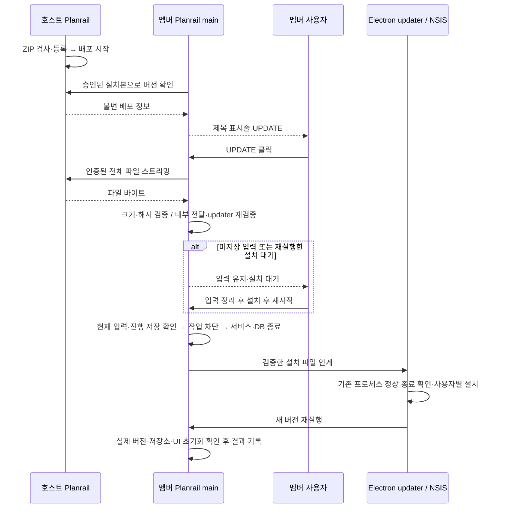

# 호스트 배포 기반 Planrail 업데이트 설계

상태: **승인된 설계 — Q1~Q20 및 문서 전체 확정, 0.8.0 구현**. 2026-11-11.
사용자가 ‘확정하고 구현진행해’로 전체 설계와 구현을 승인했다. 설계 당시0.7.0에는 이 기능이 없었다. 현재 구현과 실제 Windows 미검증 범위는 [구현·검증 기록](../implementation/2026-11-11-lan-app-updates.md)을 따른다. 아래 소스 조사·검토 후보는 당시 설계 근거로 보존한다.

이 문서는 [LAN 공유](lan-project-sharing.md)의 호스트 신원·IP·설치본 승인과 [배포 정책](../release/policy.md)의 Windows 11 x64·사용자별 설치·서명 없는 비공개 CI 배포를 이어간다. 기존 개인 자료·공유 자료·알림·설정·연결 자격을 보존한다. 아래 **기술 구체화**는 작성자의 제안이며 Q1~Q20의 직접 답변과 구분한다.

## 목적과 범위

별도 배포 서버 없이 호스트 PC가 업데이트 파일을 보관·제공한다. 멤버는 새 버전을 자동 확인하고, 제목 표시줄에서 `UPDATE`를 한 번 누르면 다운로드·검증·안전한 종료·설치·재실행을 진행한다. 미저장 입력이나 실패가 있으면 사용자 작업을 보존하고 대기한다. 멤버가 EXE를 직접 찾아 실행하는 방식이 아니다.

- 호스트 포함 최대6PC의 기존 사내 사용을 대상으로 한다. 승인된 모든 멤버에게 제공하며 프로젝트 공유 대상 여부와 분리한다.
- 호스트는 기존 방식으로 먼저 수동 설치하고 CI 업데이트 ZIP을 별도로 등록한다. **호스트 앱을 설치하는 것만으로 배포 파일이 등록되지는 않는다.**
- 첫 도입에서는 업데이트 기능을 포함한 버전을 호스트와 멤버에 한 번 수동 설치해야 한다. 기존0.7.0을 이 기능으로 자동 전환할 수 있다고 안내하지 않는다.
- 외부 서버·공유 폴더·Windows 서비스·로그인 자동 실행·호스트 자체 자동 업데이트·차등 다운로드·다운그레이드·자동 롤백은 이번 범위에서 제외한다.
- 앱 실행·트레이 상태에서만 확인·다운로드한다. 종료된 앱을 깨우지 않는다. 설치 중에는 앱이 종료되므로 동기화와 알림이 잠시 중단된다.

## 확정된 사용자 결정

| 질문 | 결정 |
| --- | --- |
| Q1 | 프로젝트 공유 여부와 관계없이 연결 승인이 유효한 모든 멤버에게 제공. PC별 선택 배포 없음 |
| Q2 | UPDATE는 멤버에게 제공. 호스트는 수동 설치 |
| Q3 | 호스트의 등록·배포 시작/중지·버전 확인은 기존 공유 설정 안의 ‘업데이트 배포’에서 관리 |
| Q4 | 연결 성공·재연결 때와 연결 중5분마다 확인. 앱 시작·일정 동기화를 기다리게 하지 않으며 클릭 전 파일 다운로드 없음 |
| Q5 | 새 버전이 있을 때만 제목 표시줄의 Planrail 옆에 작고 둥근 테두리의 `UPDATE` 버튼 표시 |
| Q6 | 다운로드 중 편집 허용. 검증 완료 후 저장이 끝나고 미저장 입력이 없으면 자동 설치·재실행. 미저장 입력은 버리지 않음 |
| Q7 | CI 업데이트 ZIP 하나를 선택해 검사·가져오기 |
| Q8 | 등록·검사 후 버전과 용량 표시. 별도 ‘배포 시작’으로 공개. 등록 실패는 기존 배포 유지 |
| Q9 | UPDATE 아래 작은 진행 팝오버에 버전·진행률·검증 상태 표시. 닫아도 다운로드 계속 |
| Q10 | 미저장 입력으로 한 번 대기했다면 정리 후 ‘설치 후 재시작’을 다시 눌러 진행. 입력이 깨끗해졌다는 이유만으로 재시작하지 않음 |
| Q11 | 다운로드 취소·재시도 제공. 취소 시 임시 파일 삭제, 재시도는 처음부터. 실제 설치 시작 후 앱 내 취소 없음 |
| Q12 | 배포 중지를 확인하면 다운로드와 미설치 대기 취소. 설치된 앱은 되돌리지 않음. 검증 완료한 오프라인 멤버는 중지를 알 수 없어 설치 가능 |
| Q13 | 첫 버전은 파일 전체 자동 다운로드. 차등 다운로드는 후속 범위 |
| Q14 | 호스트와 같은 정식 버전만 배포. 멤버의 현재 버전보다 높은 버전만 제안. 테스트 배포본 제외 |
| Q15 | 다운로드 실패 이유 표시·불완전 파일 정리·수동 재시도. 현재 앱은 계속 사용 |
| Q16 | 검증된 대기 파일은 재실행 후 유지·재검증하되 명시적으로 설치. 일반 시작·Exit만으로 설치하지 않음 |
| Q17 | 이미 확인한 새 버전은 호스트 연결이 끊겨도 UPDATE를 비활성 상태로 유지. 검증된 파일은 오프라인 설치 허용. 새 버전 정보가 없으면 숨김 |
| Q18 | 새 배포본으로 교체한 사실을 확인하면 이전 다운로드·대기 취소. 새 버전은 다시 UPDATE를 눌러 선택 |
| Q19 | 기존 인증·암호화 연결로 다운로드·검증한 뒤 멤버 PC 내부에서 Electron 자동 업데이터에 전달 |
| Q20 | 호스트는 현재 배포본과 등록 후보 한 벌만 유지. 교체본은 사용 중인 다운로드 종료 후 정리. 중지본은 등록 상태로 보존. 멤버 설치 파일은 새 버전 정상 실행 확인 후 정리 |

앞선 대화에서 확정한 호스트 보관 위치는 `%LOCALAPPDATA%\Planrail\updates\<version>\`이다. UI의 연결 상태 아이콘·최소화·최대화·닫기와 기존 트레이 동작은 유지한다.

## 설계 당시 구현과 접근 방식

기준 소스는 `2fc8645a3e307423d82adcb6966613bca4fab76b`의0.7.0이다. [package.json](../../package.json)은 Electron45.2.1·electron-builder26.18.0을 사용하며 electron-updater는 없다. [builder 설정](../../electron-builder.yml)은 `publish: null`, [빌드 스크립트](../../scripts/release/build-windows.mjs)는 `--publish never`다. 현재 [CI](../../.github/workflows/app.yml)는 EXE·SHA256·release manifest·사용 안내를 업로드하며 자동 업데이트용 ZIP 계약은 없다.

기존 [transport](../../src/main/sharing/transport.ts)는 고정 호스트 인증서·SAN·핀과 설치본 자격을 사용한다. JSON 응답16MiB·요청1MiB·5초 제한을 가지며 [host](../../src/main/sharing/host.ts)는 현재 모든 소켓을5초 뒤 닫는다. 대용량 설치 파일을 이 JSON 경로에 그대로 넣을 수 없다. [종료 보호](../../src/main/close.ts)와 [bootstrap](../../src/main/bootstrap.ts)의 비동기 종료만으로 설치 프로그램 시작 전에 DB가 닫혔다고 보장할 수도 없다.

검토한 접근:

1. **선택 — 기존 Node TLS 다운로드 + 내부 전달 + electron-updater(Q19).** 현재 신원 확인 방식을 유지하고 공개 updater API를 사용한다. 검증 파일을127.0.0.1에 한시적으로 제공하므로 추가 로컬 읽기·복사·공간이 필요하다. 별도 LAN 서버를 멤버에 열지 않는다.
2. updater가 호스트 HTTPS에 직접 접속: 복사를 줄이지만 Electron 전용 세션의 인증서 검증·IP/SAN 대응·신뢰 변경 후 캐시 처리 검증이 추가로 필요해 선택하지 않았다.
3. updater 내부 HTTP executor 교체: 기존 TLS를 직접 연결할 수 있으나 검토 버전의 공개 타입 API가 아니므로 유지보수 결합이 커진다. 선택하지 않았다. custom provider만으로 다운로드 전송 계층이 교체되는 것도 아니다.

검토 후보는 공식 [electron-updater6.8.11](https://registry.npmjs.org/electron-updater/6.8.11)이다. builder26.18.0과 runtime9.7.0을 공유하지만 Windows 실행 호환성은 아직 미검증이다. 구현 시 정확한 버전을 고정하고 검증하며, 다른 버전으로 바꾸면 설치·전송 계약을 재검토한다.

## 사용자 흐름과 화면

### 호스트

트레이 연결 상태 → 공유 설정 → 업데이트 배포에서 ZIP 선택, 검사 상태, 등록 버전·용량, 현재 배포 버전을 보여준다. 파일 검사가 성공해야 ‘배포 시작’을 사용할 수 있다. 공유 서버가 중지 상태이면 등록은 가능하나 배포 제공은 시작할 수 없고 기존 공유 시작 경로를 안내한다.

호스트의 실제 설치 버전과 다른 파일은 배포 시작을 막는다. 등록 후보를 검사하는 동안 기존 배포는 계속한다. 실패하면 실패 이유를 해당 영역에 남기며 기존 파일·배포 상태를 변경하지 않는다. ‘배포 중지’는 파일 삭제와 다르며 다시 명시적으로 배포할 수 있다.

### 멤버

[Titlebar](../../src/renderer/components/Titlebar.tsx)의 브랜드 영역을 `아이콘 / Planrail / UPDATE / 기존 연결 상태` 순서로 구성하는 기술 제안이다. 오른쪽 창 버튼은 유지한다. UPDATE는 드래그 영역에서 제외하고 Tab·Enter·Space를 지원한다. 기존 다크·스틸 블루 스타일을 사용하며 크기·간격의 세부 수치는 구현자가 정한다.

진행 팝오버는 UPDATE 아래에 고정하고 화면 밖으로 나가지 않게 배치한다. 버전·받은 용량/전체 용량·전송 진행률과 ‘검증 중’, ‘설치 대기’, 실패 이유를 구분한다. 다운로드100%는 설치 완료를 뜻하지 않는다. X·Escape·바깥 클릭은 팝오버만 닫고, ‘업데이트 취소’가 작업을 취소한다. 최소화·트레이 숨김 중에도 이미 시작한 작업은 계속한다. 시스템 오류를 일정 폼의 필드 오류나 저장 성공 토스트로 대체하지 않는다.

| 상태 | 버튼·팝오버 동작 |
| --- | --- |
| 개인/호스트 역할, 미승인 멤버, 새 버전 없음 | UPDATE 숨김 |
| 새 버전 확인·연결 가능 | UPDATE 클릭 즉시 해당 배포본 다운로드 |
| 새 버전 확인 후 일시 연결 끊김·아직 검증 파일 없음 | UPDATE 표시·비활성. 접근 가능한 설명으로 연결 필요 안내 |
| 다운로드/검증 | UPDATE로 진행 팝오버 다시 열기. 편집 가능·중복 작업 차단 |
| 검증 완료·저장 중 | 저장 종료 대기. 새 설치 절차는 저장 commit 이후에만 진행 |
| 미저장 입력 발견 | 입력 유지·설치 대기. 정리 후 ‘설치 후 재시작’ 활성화 |
| 대기 파일을 보유한 앱 재실행 | 재검증 후 설치 대기. 클릭 없이 설치하지 않음 |
| 전송·검증 실패 | 이유와 ‘다시 시도’. 신뢰·권한 오류는 해당 문제가 해결되기 전 재시도 제한 |
| 중지/교체/승인 취소 확인 | 이전 작업 취소. 새 배포본이 있으면 별도 UPDATE로 시작 |
| 설치 준비·인계 | 편집 잠금·‘설치 후 다시 시작합니다’. DB 종료·인계가 끝나기 전 설치 성공 표시 금지 |

## 기술 구체화: 배포 묶음과 신뢰

### ZIP 계약

향후 비공개 CI 산출물에 정식 업데이트 ZIP을 하나 추가한다. `latest.yml`, NSIS EXE, 생성된 `.blockmap`, release manifest, SHA256 파일을 포함한다. blockmap은 보존하지만 첫 버전 다운로드에 사용하지 않는다. 기존 사용 안내는 선택 파일로 허용한다. `app.asar`나 blockmap 하나만 가져오는 형식은 지원하지 않는다.

manifest는 schema version, 고정 appId, 제품 버전, Windows/x64/NSIS/사용자별 설치, source SHA, 파일별 basename·크기·SHA256·SHA512, `validationUpdateOnly`, 서명 여부를 명시하도록 확장한다. `latest.yml`의 버전·파일명·크기·SHA512와 일치해야 한다. 모든 메타데이터는 제한된 스키마로 파싱하고 실행하지 않는다. 합성 `UPDATE-TEST-ONLY`, prerelease, 다른 제품·CPU·설치 범위, 경로/URL이 포함된 파일명, 해시 불일치를 거부한다.

가져오기는 독립 임시 폴더에서 수행하고 성공한 묶음만 원자적으로 등록한다. ZIP의 절대 경로·`..`·드라이브 경로·심볼릭 링크·중복/대소문자 충돌 항목·허용하지 않은 파일을 거부한다. 압축 크기·해제 후 크기·항목 수와 남은 디스크 공간에 한도를 적용한다. 구체적 한도는 실제 CI 산출물 크기를 근거로 구현 계획에 고정하며 무제한 압축 해제를 허용하지 않는다. 등록은 installer를 실행하지 않는다.

버전과 파일 해시 묶음은 불변이다. 같은 버전·동일 바이트의 재등록은 멱등 처리하고, 이미 알려진 버전의 다른 바이트는 거부한다. 다시 빌드한 다른 파일을 배포하려면 버전을 올린다. 버전 비교는 숫자 세 부분의 정식 버전으로 하며 문자열 사전순 비교를 쓰지 않는다. 배포 시작 시 설치된 호스트의 버전과 source SHA가 묶음과 맞는지 확인하는 기술 제안이다.

현재 서명 없는 비공개 배포 정책을 유지한다. SHA256/SHA512는 파일과 메타데이터의 일치를 검증하며 **개발자 서명이나 빌드 출처를 암호학적으로 증명하지 않는다**. 신뢰 경계는 호스트 운영자가 신뢰하는 비공개 CI에서 직접 받아 등록하는 절차와 승인된 호스트 인증이다. `sourceSha` 등의 값도 독립적인 서명 증거로 표현하지 않는다. 코드 서명·서명 manifest 키 관리는 이번 기능에 추가하지 않는다.

### 보관과 공개

- 호스트 파일: `%LOCALAPPDATA%\Planrail\updates\<version>\`. 배포본·후보별 해시와 상태는 별도 원자적 catalog에 저장한다. 같은 버전의 중복 복사본을 만들지 않는다.
- 멤버 파일: 같은 updates 루트 아래 `member\<hostId>\<releaseId>\`에 두는 제안이다. 부분 파일, 검증 완료 파일, 설치 시도 기록과 updater 임시 캐시를 구분한다. 실제 DB·프로필 위치는 기존 `%APPDATA%\SimpleTimeline`을 유지한다.
- catalog는 단일 writer가 원자적으로 교체한다. 배포 시작·중지·교체마다 영속 증가 순번을 부여한다. releaseId는 불변 파일 묶음의 digest, publicationId는 공개 세대다. 같은 파일의 재배포도 새 공개 세대로 구분한다.
- 공개 정보에는 hostId·배포 순번·publicationId·releaseId·버전·크기·해시·업데이트 프로토콜을 포함한다. 후보 등록은 아직 멤버에게 보이지 않는다. 파일이 완성되기 전에 catalog가 가리키지 않는다.
- Q20에 따라 현재 배포본과 후보 한 벌만 유지한다. 교체된 묶음은 새 다운로드를 막고 열려 있는 스트림의 종료·취소를 기다려 삭제한다. 중지한 현재 파일은 등록 상태로 남긴다. DB·일정·원본 사용자가 선택한 ZIP을 정리 대상으로 삼지 않는다.
- 앱 재실행 때 마지막 배포 상태를 복원하되, 공유 시작 상태·파일 검증·호스트 버전 일치를 다시 확인한다. 호스트를 새 버전으로 수동 설치하여 이전 배포본과 달라졌으면 이전 공개를 중지 상태로 전환하고 새 ZIP 등록을 안내한다. 호스트 앱 업데이트만으로 새 파일을 임의 생성하지 않는다.
- catalog 손상이나 파일 누락 시 배포를 중단하고 오류를 표시한다. 임의 파일을 찾아 자동 배포하거나 이전 상태를 추정하지 않는다. 설치본 정리 실패는 다음 시작 때 제한적으로 재시도하되 정상 설치 성공 자체와 구분한다.

## 기술 구체화: 전송·권한·버전 확인

### 기존 공유와 독립된 업데이트 계약

기존 호스트의 LAN 주소·HTTPS 포트를 사용하되 업데이트용 작은 JSON 상태 조회와 바이너리 스트림을 별도 처리한다. 제안 경로는 `/v1/updates/status`, `/v1/updates/file/<releaseId>/<fileId>`이며 path segment는 main이 제한된 ID로 만든다. 파일 경로를 클라이언트 입력에서 조합하지 않는다. 실제 요청/응답 타입과 API 이름은 구현 계획에서 고정한다.

- 요청마다 실제 접속 IP·활성 설치본 자격·승인 PC를 검사한다. 프로젝트 ACL이 없는 승인 PC도 업데이트 대상이다. 승인 대기·승인 취소·다른 설치본에는 파일과 배포 정보를 제공하지 않는다.
- 기존 호스트 신원·인증서 SAN·DER pin·TLS 검증과 필요 시 localAddress 선택을 유지한다. redirect는 거부하고 등록된 호스트 외의 URL로 전송하지 않는다. 외부 인터넷이나 SMB로 fallback하지 않는다.
- 동기화의5초/16MiB 제한을 전역으로 늘리지 않는다. 요청을 제한 시간 내 분류·인증한 뒤, 업데이트 파일 응답만 전용 idle/전체 제한·정확한 길이·취소·backpressure를 적용한다. TLS handshake·요청 헤더 제한은 유지한다. 기존 host의 무조건5초 socket 종료 타이머도 이 경계에서 분리해야 한다.
- 설치 파일 전체를 메모리에 올리지 않는다. streaming hash·디스크 쓰기와 이벤트 루프를 막지 않는 가져오기 작업으로 일정 저장·2초 동기화를 유지한다. PC당 다운로드 한 건, 호스트 최대5멤버의 동시 요청을 제한된 자원으로 처리하도록 검증한다. 세부 buffer·timeout·용량 상한은 구현 계획의 명시적 상수로 정한다.
- 첫 버전은 Range·부분 재개 없이 전체 파일만 받는다. 길이 초과·짧은 응답·타임아웃·중단·디스크 부족은 실패이며 불완전 파일을 정리한다. 바이트100% 이후에 해시와 형식 검증이 남아 있으면 계속 검증 상태다.

업데이트 프로토콜은 앱/일정 snapshot 버전과 분리한다. 향후 호스트를 먼저 업데이트해도 직전 멤버가 설치 파일을 받을 수 있도록 최초 updater-enabled 버전의 조회·인증·다운로드 계약을 호환 유지한다. 일정 프로토콜이 달라져 조회 전용이 되어도 유효한 신원·자격으로 업데이트 확인은 가능해야 한다. 업데이트 프로토콜 자체가 지원되지 않으면 수동 설치를 안내하고, 인증 실패를 구버전으로 가장해 우회하지 않는다. 최초 미지원 호스트의 명확한404는 기능 미지원으로 구분하며 기존 공유 기능을 오류로 바꾸지 않는다.

### 확인·배포 변경과 취소

연결 성공·재연결 및5분 주기의 조회는 중복되지 않게 직렬화하고 시작 화면을 막지 않는다. 다운로드 시작 직전과 설치 준비 직전에 최신 배포 상태를 추가 확인한다. 실패해도 정상 일정 동기화까지 실패로 처리하지 않는다.

각 작업은 호스트 신원·승인 설치본 세대·publicationId·releaseId·해시와 결합한다. 이전 작업의 늦은 응답이 새 작업이나 해제된 연결을 살리지 못하도록 세대를 검사한다. 알려진 높은 배포 순번보다 낮은 응답을 채택하지 않는다. 재배포한 같은 버전이라도 새 공개 세대는 다시 사용자 선택을 받는다.

| 관측 | 처리 |
| --- | --- |
| 정상 조회·새 버전 없음 | 파일 다운로드 없음. UPDATE 숨김 |
| 서버 중지·일시 네트워크 실패 | 새 다운로드 불가. 검증 완료 파일은 기존 신원·자격이 로컬에서 유효한 동안 오프라인 설치 가능 |
| 명시적 배포 중지/교체 확인 | 기존 작업 취소·설치 대기 무효화. 새 배포본은 별도 클릭 필요 |
| 승인 취소/삭제가 인증된 응답으로 확인됨 | 해당 연결의 다운로드·대기 무효화·파일 정리. 프로젝트 공유 종료만으로는 업데이트 권한을 없애지 않음 |
| 인증401·pin 불일치·잘못된 metadata 등 | 신뢰/자격 확인 필요 상태. 단순 오프라인으로 간주해 설치를 우회하지 않음 |
| 멤버가 직접 연결 해제·새 호스트로 재등록 | 기존 호스트 작업·대기·자격 결합을 폐기. 재승인 후 자동으로 옛 대기를 실행하지 않음 |

중지·교체·회수는 **확인한 시점**에 적용한다. 호스트는 새 스트림을 차단하고 해당 공개 세대의 활성 스트림을 종료할 수 있다. 종료만 관측한 멤버는 실패 이유를 중지로 추정하지 않고 다음 인증된 조회로 구분한다. 이미 다운로드·검증한 오프라인 PC나 이미 설치 프로그램으로 인계된 작업을 원격으로 즉시 회수할 수는 없다. 설치 인계 직전 마지막 상태 검사까지 확인된 취소가 우선하며, 이후 시작된 설치는 앱에서 되돌리거나 강제 중단하지 않는다.

## 기술 구체화: 내부 전달과 설치 조정

### 멤버 내부 전달

검증된 묶음만 main의 임시 HTTP feed로 제공한다. `127.0.0.1`의 임의 포트와 시도마다 생성한 충분히 긴 일회성 capability 경로를 사용한다. URL은 renderer·로그·LAN에 공개하지 않는다. 정확히 허용한 metadata와 EXE의 GET/HEAD만 제공하고 directory listing·redirect·임의 파일 읽기·경로 이탈·심볼릭 링크를 거부한다. capability가 없는 요청은 거부하고 가능한 요청 Origin도 제한한다. 같은 사용자 권한의 로컬 악성 프로그램까지 방어한다고 주장하지 않는다.

호스트의 `latest.yml`을 무조건 그대로 열지 않는다. 원본을 제한된 스키마로 검증한 뒤 파일명·해시·버전이 같은 로컬 상대 경로의 metadata를 만든다. updater의 공개 generic provider에 내부 URL을 지정하여 updater가 다시 검증·캐시하게 한다. 자격 토큰이나 호스트 인증서가 로컬 feed에 넘어가지 않는다. updater의 확인·캐싱이 끝나면 feed를 닫고 필요하지 않은 복사본을 정리한다. 설치 직전 실제 인계 파일의 크기·해시를 다시 확인한다.

제안하는 updater 옵션은 `autoDownload=false`, `autoInstallOnAppQuit=false`, `allowDowngrade=false`, `disableWebInstaller=true`, `disableDifferentialDownload=true`다. 설치는 명시적인 coordinator에서만 시작한다. 일반 앱 종료 이벤트나 `update-downloaded` 핸들러가 곧바로 설치를 시작하지 않는다.

### 입력 보호와 종료 순서

설치 준비는 다음 순서를 갖는다. 다운로드 중에는 기존 편집을 유지한다.

1. 실제 받은 버전·승인 세대·배포 상태·파일 검증과 설치 가능 조건을 확인한다. 온라인 조회 실패를 허용하는 것은 위의 단순 오프라인 경우뿐이다.
2. renderer에서 현재 미저장 입력·진행 저장을 다시 확인한다. 일정/프로젝트 패널 외에 알림 간편 편집·공유 설정 등의 저장되지 않은 입력도 포함한다. 상태를 확인할 수 없으면 설치 대기 또는 오류이며 입력을 추정해 버리지 않는다.
3. 진행 중인 저장의 commit/실패가 확정될 때까지 기다린다. 미저장 입력이 발견되면 대기 상태를 영속 기록한다. 한 번 대기하거나 앱을 재실행한 작업은 Q10/Q16의 명시적 재시작 클릭이 필요하다.
4. 설치를 시작할 순간 renderer 편집을 잠그고 마지막 clean acknowledgment를 받는다. main에서도 새 mutation IPC·알림 클릭에 의한 편집·동기화·타이머·새 전송을 차단한다. 이 경계 전에 들어온 저장은 완료·실패까지 추적하며 모두 끝나기 전 종료하지 않는다.
5. 동기화·알림·공유 서비스·열린 파일/소켓을 정상 정리하고 모든 저장소 작업과 SQLite 종료를 **await**한다. 실패를 삼켜 설치로 진행하지 않는다. 아직 저장소를 닫지 않은 실패는 편집을 안전하게 복구하고, 일부 teardown 후 복구할 수 없으면 읽기/편집을 막은 안내와 일반 앱 재실행 경로를 제공한다. 빈 DB 생성이나 업데이트 강행으로 복구하지 않는다.
6. 인계 시도 ID·기존/목표 버전·releaseId·해시·단계 기록을 앱 설치 폴더 밖에 원자적으로 저장한다. 기록 실패이면 installer를 실행하지 않는다. 준비가 모두 완료된 뒤 `quitAndInstall(true, true)`에 인계한다. 정상 before-quit 보호가 이미 승인된 설치 종료를 다시 막지 않도록 별도 종료 이유를 사용한다.

updater6.8.11은 NSIS를 실행한 다음 app.quit를 예약한다. builder26.18.0의 기본 `--updated` 경로는 앱 종료를 짧게 기다린 뒤 강제 종료할 수 있다. 따라서 비동기 will-quit에 DB 정리를 맡기는 것만으로는 충분하지 않다. **설치 프로그램에도 정상 종료 확인·제한 시간 초과 시 설치 중단·강제 kill 금지**를 적용해야 한다. 제공되는 `customCheckAppRunning` hook 또는 동등하게 검증한 방식으로 구현하고, 실제 설치 경로의 프로세스가 안전하게 종료됐는지 판별할 수 없으면 설치하지 않는다.

미저장 입력을 무시하거나 이미 성공한 저장을 취소하는 방법으로 종료 시간을 맞추지 않는다. 현재 사용자 설치 경로와 고정 appId를 유지하고 updater의 installDirectory를 staging 경로로 지정하지 않는다. 기본적으로 기존 HKCU InstallLocation을 재사용한다. 관리자 권한을 요구하는 패키지는 제공하지 않으며 권한 거부·보안 프로그램 차단을 우회하지 않는다.

### 실패와 재시작 확인

updater 호출이 반환됐다는 것은 설치 성공이 아니다. 다음 실행에서 실제 설치 버전이 목표와 일치하고 기존 프로필의 저장소 초기화·renderer 준비가 정상 완료됐을 때 성공을 기록한다. 현재 구현의 startup 계측을 재사용할 수 있으나 버전 문자열만 보고 DB·화면 성공을 추정하지 않는다.

- 앱 재실행 후 같은 구버전이면 설치 미완료로 안내하고, 검증된 파일의 재시도는 다시 명시적으로 선택한다. 무한 자동 설치를 하지 않는다.
- 파일 잠금·설치 실행 실패·재실행 실패는 성공으로 표시하지 않는다. 앱이 종료된 채라면 사용자가 기존 바로가기를 실행하거나 정상 정식 설치본으로 수동 복구해야 할 수 있다.
- 목표 버전이 뜨더라도 migration/DB/UI 초기화가 실패하면 업데이트 완료로 기록하지 않는다. 기존 원본 보존·오류 안내 정책을 따른다. 성공한 설치를 자동으로 구버전으로 되돌리거나 새 DB를 만드는 기능은 없다.
- 확인된 새 버전 성공 후 전송/내부 feed/updater의 설치 캐시를 정리한다. 설치 프로그램이 아직 사용하는 파일은 지연 정리하며 실패해도 일정 자료는 건드리지 않는다. 의도적으로 대기 중인 검증 파일에는 자동 만료를 적용하지 않는다.
- 다운로드 도중 일반 Exit·프로세스 종료가 발생하면 불완전 파일은 정리하고 다음 실행에서 자동 재개하지 않는다. 이미 검증된 대기는 Q16을 따른다. X/Alt+F4의 트레이 숨김은 종료가 아니므로 다운로드가 계속된다.

## 책임 경계와 필요한 구현 변경

main이 catalog·ZIP 검사·네트워크·파일·검증·설치 조정을 소유한다. preload는 상태 조회/구독과 등록 선택·배포 시작/중지·다운로드·취소·재시도·설치 요청 같은 제한된 동작만 노출한다. 등록 파일 선택은 main의 파일 선택창에서 수행한다. renderer가 arbitrary URL·경로·명령·updater 옵션을 넘겨 실행할 수 없게 한다. host 전용 명령과 member 전용 명령은 main에서 역할과 요청 창을 검사한다.

멤버 상태에는 버전·파일 크기·받은 바이트·작업 단계·허용 동작·사용자용 오류 코드만 포함한다. 토큰·개인 일정·호스트 전체 경로·capability URL을 내보내지 않는다. 상태 구독은 재연결 가능한 snapshot+revision 방식으로 하여 팝오버를 닫았다 열어도 일관되게 복원한다. updater 설치 캐시의 실제 위치는 고정된 앱 정체성과 해당 라이브러리 설정에서 확인하고 관리 대상 파일만 정리한다.

향후 구현은 [main](../../src/main/), [preload](../../src/preload/), [API 타입](../../src/shared/), Titlebar·공유 설정과 설치/CI 경로를 포함한다. 업데이트 catalog·시도 기록은 별도 파일 상태 저장소로 두는 제안이며 일정 DB schema를 바꿀 필요는 없다. catalog의 원자적 교체·손상 복구·최소 권한·충돌 방지는 테스트해야 한다. 기존 저장 API·업무 규칙을 업데이트 상태와 같은 트랜잭션으로 결합하지 않는다.

빌드 설정에는 metadata를 생성할 generic publish 설정을 추가하되 `--publish never`를 유지한다. 실제 호스트 URL·자격은 빌드에 넣지 않는다. 패키지의 기본 feed는 네트워크 요청이 일어나지 않는 placeholder로 두고 main이 내부 feed를 지정하기 전 모든 check를 막는다. 이는 기존 `publish: null`을 바꾸는 **설계 당시 향후 구현 요구**였다. 0.8.0 구현에서는 이를 반영했으며 아래 설계 당시 검증과 현재 구현 검증은 구분한다.

## 검증 기준

다음은 구현 후 통과해야 할 기준이다. 이 문서 작성만으로 통과한 것으로 간주하지 않는다.

| 범위 | 필수 확인 |
| --- | --- |
| ZIP·등록 | 정식 bundle 일치, fixture·prerelease·다른 appId/CPU/설치 범위 거부, ZIP 경로 이탈·중복·크기 제한·디스크 부족, 실패 시 기존 공개 유지 |
| 버전·catalog | 문자열 비교 금지, 같은 버전 다른 바이트 거부, host 버전/source 일치, 등록과 공개 분리, 중지/교체/재배포 세대, crash 시 부분 공개 없음 |
| 신원·전송 | 실제 IP·설치본·pin·SAN, 승인 취소/재등록·인증 오류, redirect·권한 없는 파일 접근 거부,5초 넘는 정상 파일 전송, 잘린 응답·해시 불일치·중단·동기화 병행 |
| 상태·UI | 새 버전일 때만 UPDATE, 키보드·드래그 제외·popover 위치, 편집 중 다운로드, 팝오버 닫기와 취소 구분, 수동 retry, offline/재실행/명시 설치 |
| 취소 경쟁 | download 완료 직전 중지, 검증 후 교체, 신원 세대 변경, 설치 인계 직전 취소, 늦은 응답이 이전 작업을 부활시키지 않음 |
| 내부 전달 | loopback 전용 bind, capability·경로·Origin 제한, 원본 metadata 외부 URL 거부, updater 재해시, feed 종료·임시 파일 정리 |
| 안전 종료 | 모든 입력·pending save·DB transaction·notification/sync 종료 대기, renderer 응답 실패, DB close 실패, 일반 Exit는 설치하지 않음, NSIS 강제 kill 없음 |
| 실제 설치 | 격리 Windows VM의 현재/사용자 지정/legacy 설치 경로, 관리자 권한 없는 silent 설치·재실행, DB·알림·설정·공유 자격 보존, 파일 잠금·실행 실패·구버전 재실행 감지 |
| 호환성 | 최초 updater bootstrap 수동 설치, 호스트 선행 업데이트·멤버 이전 버전의 업데이트 경로 유지, 미지원 프로토콜 안내, 합성 fixture가 실제 host에 등록되지 않음 |
| 인수 | 실제 Windows 11 호스트+멤버, 방화벽·회사 보안 프로그램·절전·트레이·연결 끊김·오프라인 검증 파일·최대6PC. Linux 테스트가 이 결과를 대신하지 않음 |

설치형 테스트는 기존 AppData가 없는 일회성 Windows 환경에서만 수행한다. 테스트용 fixture를 정식 host importer가 허용하도록 제품 검증을 약화하지 않는다. 테스트 전용 assembly나 격리된 test harness가 필요하면 제품 배포 경로와 구분하고, 마지막에는 서로 다른 실제 정식 버전으로도 확인한다.

## 설계 당시 검토·완료 경계

- 설계 당시에는 사용자 Q1~Q20, 저장소 소스, 로컬 builder26.18.0 및 공식 updater6.8.11 패키지 소스를 대조했다. 의존성을 설치하거나 updater·installer를 실행하지 않았다.
- 실제 Windows 동작·다운로드·UI·CI update ZIP·새 설치 경로는 모두 **미검증**이다.
- 문서 전체와 구현 진행을 승인받았다. 기술 구체화의 수치 상한·함수/테이블/IPC 이름·정확한 CSS는 제품 계약을 유지하는 범위에서 구현 계획으로 넘긴다. 아래 설계 검증은 제품 구현 검증을 대신하지 않는다.
- 독립 builder 검토 결과: 구현 계획 전에 사용자가 추가로 결정해야 할 중대한 누락 없음. 이는 Windows 구현·실행 검증을 대신하지 않는다.
- 문서 검증: 기준 HEAD `2fc8645a3e307423d82adcb6966613bca4fab76b` + 문서 변경 작업 트리, Linux x64·Node24.22.1에서 `node scripts/harness/run.mjs verify` 통과(하네스22개, 실패0). 이 문서·문서 탐색표·배포 정책의 로컬 링크 대상72개 모두 존재하며 결정 표 Q1~Q20 누락 없음. 제품 테스트·설치 실행은 하지 않았다. 기존 MVP 지도는 완료 상태다.

주요 기술 근거는 공식 [updater6.8.11 배포 소스](https://registry.npmjs.org/electron-updater/-/electron-updater-6.8.11.tgz)의 `out/BaseUpdater.js`(설치 실행 후 quit), `out/NsisUpdater.js`(NSIS 인수·검증), `out/AppUpdater.js`/`out/providers/Provider.js`(전체/차등 전송·metadata)와 설치된 builder26.18.0의 `templates/nsis/include/allowOnlyOneInstallerInstance.nsh`(종료 대기·강제 종료·custom hook), `out/publish/PublishManager.js`(로컬 metadata 생성과 publish 제어)다. 버전이 다른 최신 master의 동작을 이 버전의 근거로 사용하지 않았다.

## 구현과의 연결 (2026-11-11)

0.8.0은 위 Q1~Q20을 구현한다. 실제 인증 파일 경로는 `/v1/updates/<releaseId>/<fileId>`이며 설계 중의 `/file` 경로 제안을 대체한다. Actions의 직접 가져오기 대상은 `Planrail-LAN-UPDATE-<SHA>` artifact ZIP이다. 별도 일반 설치 artifact 내부 ZIP과 구분하며 payload의 해시 검증은 GitHub ZIP 컨테이너 메타데이터에 의존하지 않는다.

renderer 설치 가드는 주요 편집·빠른 알림·공유 주소·참여자 입력·날짜 임시 입력을 확인하고 모든 입력을 먼저 동기식으로 차단한 뒤 저장 완료를 기다린다. 해제·unmount 뒤 늦은 응답은 승인하지 않는다. 검증 범위·환경·실제 Windows 한계는 [구현 기록](../implementation/2026-11-11-lan-app-updates.md)을 따른다. 이 문서의 조사 당시 미검증 설명을 자동으로 실기 통과로 해석하지 않는다.
