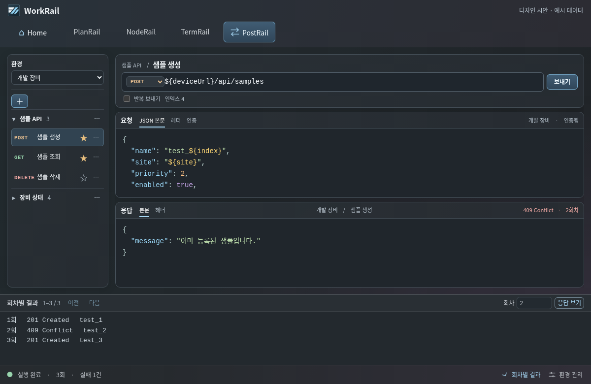
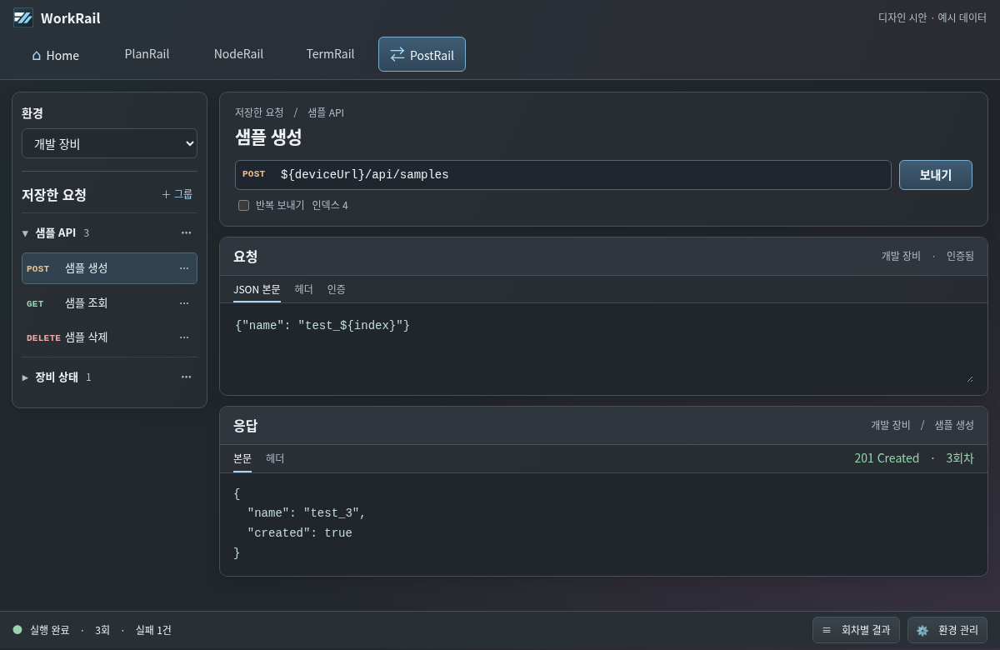
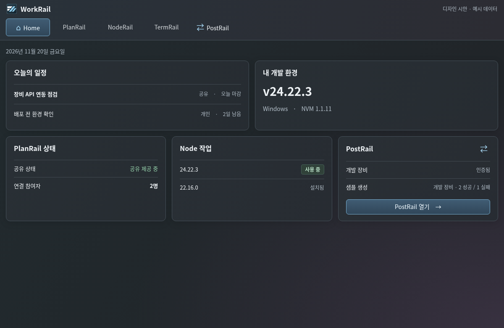

# PostRail 최종 설계 · 작업 화면과 Home 위젯

**2026-11-20 설계 확정 · 제품 구현 전.** 사용자가 최종 승인한 화면은 `795837d`의 PostRail 작업 화면과 Home 위젯이다. 이 문서를 구현 기준으로 사용한다. [PostRail 시안](mockups/postrail-workspace.html) · [Home 시안](mockups/postrail-workspace.html#home)

[첫 버전 Q1~Q12](postrail.md)의 전송·저장·반복 인덱스·오류 처리 규칙과 [재검토에서 확정한 동작](postrail-review.md)을 함께 적용한다. 토큰의 재사용 범위, 인증 실패에 따른 회차 중지, 요청·응답 배치, footer 로그, 요청 목록 및 Home 즐겨찾기는 이 문서의 최종 결정을 따른다. 공통 응답 대기 시간은 요청별로 재정의할 수 있다. 공통 기본값의 구체적인 초 단위 수치는 구현 시 정한다.

## PostRail에서 요청을 보내는 흐름

1. 왼쪽 패널 상단에서 **＋ → 요청 추가**로 요청을 만들거나 **＋ → 그룹 추가**로 그룹을 만든다. 통합 ＋ 버튼은 보내기 버튼과 같은 파란색을 사용한다. 이름·URL·그룹을 입력해 저장하면 오른쪽 편집기에 새 요청이 열린다. 선택 중인 요청이 있으면 같은 그룹, 선택이 없으면 미분류가 기본이다. 그룹의 **… → 요청 추가**를 이용하면 해당 그룹이 미리 선택된다.
2. URL 왼쪽의 **HTTP 메서드 드롭다운**에서 GET·POST·DELETE를 선택한다. GET은 본문 탭을 끄고, DELETE는 본문을 선택적으로 사용할 수 있다. 작성 중인 본문은 메서드를 전환해도 보관한다. 새 요청의 기본값은 GET이다. 편집기에서는 선택한 메서드로 보낸다. 편집 내용이 달라지면 요청 이름 바로 오른쪽에 **변경 저장**이 나타나며, 누르면 저장 요청과 Home 즐겨찾기에도 반영된다. POST도 기본 버튼은 **보내기**다. 한 번 보내려면 횟수를 입력할 필요가 없다. POST에서 **반복 보내기**를 켰을 때만 양의 정수를 입력하고 ‘N회 보내기’를 사용한다. 반복을 끄면 한 건만 발송한다. 인덱스 있는 단건도 번호를 사용한다. GET과 DELETE에는 반복 옵션이 없다.
3. URL 아래의 전체 가로 공간에서 요청 헤더·본문·인증을 편집한다. 응답은 바로 아래에서 본문·헤더를 전환한다. 응답 상단에는 실제 실행한 요청명·환경·선택된 회차를 표시해 편집기의 현재 환경과 구별한다.
4. PlanRail처럼 페이지 하단에 상태 바를 둔다. 왼쪽에는 실행 상태와 건수, 오른쪽 끝에는 **환경 관리**, 그 왼쪽에는 **회차별 결과**가 있다. 접힌 상태에서 ‘회차별 결과’를 누르면 하단 상태 줄은 제자리에 있고, 그 바로 위로 footer 전체 너비의 로그가 펼쳐진다. 로그는 복사할 수 있는 읽기 전용 일반 텍스트다. 회차당 한 줄에 번호·상태·사용한 인덱스를 표시한다. 특정 응답은 로그 도구 줄에 회차 번호를 입력하고 ‘응답 보기’를 눌러 확인한다. 같은 버튼이나 Escape로 접어도 실행과 선택 응답을 유지한다. 실패나 서버 반영 여부가 불명확한 회차 수는 닫힌 상태에서도 알 수 있게 한다.

### 목록 메뉴와 팝업

| 진입점 | 동작 |
| --- | --- |
| 요청 옆 … | ‘수정’, ‘복제’, ‘삭제’를 제공한다. ‘복제’를 누르면 같은 그룹에 독립된 요청이 즉시 생기고 선택된다. |
| 그룹 옆 … | ‘요청 추가’, ‘수정’, ‘삭제’를 제공한다. 그룹만 삭제하면 소속 요청은 별표와 다음 인덱스를 유지한 채 미분류로 이동한다. 미분류 그룹 메뉴에는 ‘요청 추가’를 둔다. |
| 수정 팝업 하단 | 그룹은 **그룹 삭제**, 요청은 **요청 삭제**를 가장 왼쪽에 둔다. **닫기**와 **저장**은 오른쪽에 둔다. 어느 경로에서든 삭제 확인을 닫으면 자료를 유지한다. |

요청·그룹 추가/수정, 삭제 확인, 환경 관리, 반복 보내기와 안내 팝업은 PlanRail **알림 설정**을 따른다. 호출한 버튼 아래 8px에 열고 화면 경계에 맞춰 보정한다. 최대 폭 340px, 안쪽 여백 16px, 모서리 14px, 제목 16px, 10px 유리 흐림과 투명한 배경막을 사용한다. 우상단 ×, Escape 또는 바깥 클릭으로 닫는다. 수정 창에서는 삭제 버튼만 왼쪽에 두고 닫기와 저장은 오른쪽으로 모은다. [알림 설정 컴포넌트](../../src/renderer/components/QuickReminder.tsx) · [팝업 스타일](../../src/renderer/forest-crystal.css) · [컨텍스트 메뉴](../../src/renderer/termrail/WorkspaceControls.tsx)

[통합 추가 메뉴와 변경 저장 위치](mockups/postrail-add-menu.png) · [그룹 메뉴 시안](mockups/postrail-group-menu.png) · [요청 수정 팝업 시안](mockups/postrail-request-edit.png)

### 요청 복제와 단축키

왼쪽 목록에서 **샘플 조회**를 클릭하고 **Ctrl+C → Ctrl+V**를 누르면 같은 그룹에 **샘플 조회 복사본**이 생긴다. 다른 그룹 이름에 포커스를 두고 Ctrl+V를 누르면 그 그룹에 추가한다. 마우스로는 **… → 복제** 한 번으로 같은 그룹에 복사본을 만든다. 메뉴로 복제해도 Ctrl+C로 복사해 둔 요청은 유지한다. 같은 이름이 있으면 ‘복사본 2’부터 구분한다.

복사 시점의 저장된 정의(이름·메서드·URL·본문, 제품 설계상 헤더와 실행 전 설정 참조)를 담는다. 복사본은 다음 인덱스 1, 즐겨찾기 해제로 시작한다. 발급된 토큰, 보호 변수의 실제 값, 실행 결과와 미저장 편집은 제외한다. 앱 안에서만 보관하는 요청 복사본이므로 URL·코드 편집기 등에서는 기존 시스템 텍스트 복사·붙여넣기를 사용한다. [요청 메뉴 시안](mockups/postrail-request-copy.png)

### 편집 공간과 하단 상태 바

좌우 배치에서는 왼쪽 패널이 footer 위의 작업 공간 전체 높이를 채운다. 긴 목록은 패널 안에서 스크롤하며 환경 선택과 추가 버튼을 계속 사용할 수 있다. footer 로그를 열면 줄어든 작업 높이에 맞춘다.

URL, 요청 본문과 응답 본문은 14px 고정폭을 사용한다. PostRail 페이지 안에서만 탐색·옵션 문자를 11~13px로 줄이고 각 영역의 제목과 탭을 한 줄에 둔다. 요청과 응답 코드 영역이 남은 세로 공간을 나눠 사용한다. 1200×780 시안에서 URL 입력 너비는 724px에서 793px, 요청·응답 코드 영역 높이는 각각 110px·123px에서 약 211px로 늘어났다. 좁은 창에서는 제목 줄이 줄바꿈되고 코드 영역은 스크롤할 수 있다.

**본문 구문 강조**는 요청을 입력하는 동안과 JSON 응답을 읽을 때 같은 색을 사용한다. 속성 이름은 하늘색, 문자열 값은 연두색, 숫자는 주황색, 불리언은 보라색, `null`은 청록색이다. 요청 문자열 안의 `${site}`·`${index}`는 금색으로 구분한다. 중괄호와 쉼표는 기본 전경색이다. 닫는 따옴표가 아직 없는 입력도 그대로 편집할 수 있으며, 강조 색은 원문·선택·복사·전송 데이터에 영향을 주지 않는다. 일반 텍스트 응답과 하단 회차 로그는 단색으로 표시한다. 시안에서는 큰 본문(65,536 UTF-16 코드 단위 초과)을 단색으로 전환해 색상용 요소 생성을 제한한다.

하단 상태 바는 PlanRail과 같은 외곽 스타일을 공유하도록 설계한다. 최소 높이 39px, 상하 4px·좌우 14px 여백, 간격 10px(510px 이하 6px), 12px 글자, 1px 상단 선과 같은 유리 배경이다. 우측 ‘회차별 결과’와 ‘환경 관리’는 아이콘과 글자를 한 줄에 두며, 긴 상태는 말줄임한다. [PlanRail 상태 바 CSS](../../src/renderer/workrail/status.css) · [테마 색상](../../src/renderer/forest-crystal.css)

로그를 접어 두면 화면용 문자열을 만들지 않는다. 열었을 때만 회차 범위를 읽어 텍스트 영역 하나를 갱신한다. 시안에서는 100줄씩 이전·다음으로 이동한다. 제품 구현 시에도 현재 페이지의 요약만 읽고, 응답 본문은 회차를 지정할 때 별도로 조회한다.

## 변수는 어디에서 추가하는가

**PostRail 우측 하단 → 환경 관리 → 대상 환경의 변수 목록 아래 → ＋ 아이콘 → 이름과 값 입력 → 저장**. 마지막 변수 행 아래의 ＋ 아이콘으로 새 행을 추가하고 첫 입력란으로 포커스를 옮긴다. 각 행의 오른쪽 휴지통은 해당 변수를 삭제하며, 저장해야 반영된다. 팝업 우측 상단의 ×는 창을 닫는다. 아이콘에는 툴팁과 접근성 이름을 제공한다. [환경 관리 시안](mockups/postrail-environment.png)

시안은 왼쪽에서 선택한 환경을 관리 창 제목에 표시한다. 예를 들어 개발 환경에 장비 주소를 `deviceUrl`로 등록하고, URL에 `${deviceUrl}/api/samples`를 입력한다. 같은 요청을 QA 환경에서 열면 QA에 등록한 값을 쓴다. 중복 이름과 예약 이름 `index`는 저장 전에 표시한다. 비밀번호는 보호 변수로 다루며 요청 본문·목록·Home에 원문을 노출하지 않는다. 시안의 변수 편집은 예시 일반 변수에 한한다.

## 로그인 한 번으로 여러 요청 보내기

기존 Q2·Q3은 ‘실행마다 한 번 로그인’이다. 한 번의 POST 10회에는 로그인 한 번이지만 이후 GET을 따로 보내면 다시 로그인한다. 변경 요청은 **환경·계정·로그인 설정·토큰을 받을 API 주소가 같은 동안에는 별개의 실행에서도 유효한 토큰을 재사용**하는 것이다.

- 인증을 켠 첫 요청에서 유효한 토큰이 없을 때만 로그인한다. 같은 환경에서 보낸 다음 GET, POST, DELETE 및 반복 회차에 기존 토큰을 적용한다. 인증을 끈 요청은 인증 헤더 주입이나 로그인 없이 보낸다.
- 환경 A에서 B로 옮기면 B의 상태를 조회한다. A로 돌아왔을 때 A의 토큰이 여전히 유효하면 다시 사용한다. 계정·비밀번호·로그인 설정·토큰 수신 API 주소가 바뀌거나 로그아웃하면 해당 토큰을 폐기한다. 서버가 준 만료 시각을 알면 만료 뒤 새 토큰을 발급받는다. 만료 시각이 없으면 임의의 유효 시간을 꾸며내지 않는다.
- 토큰은 메인 프로세스에서 관리한다. 지정된 API origin으로만 보내고 다른 주소로의 리디렉션을 자동으로 따라가지 않는다. 로그인 실패 시 본 요청과 인덱스 예약은 0건이다. 이미 보낸 POST는 인증 오류여도 자동으로 재전송하지 않는다.
- **토큰 수명과 401**은 최종 승인 시 기존 제안대로 정했다. 토큰은 앱 메모리에 두며 트레이로 숨기면 유지하고 완전히 종료하면 폐기한다. 인증을 사용한 본 요청이 401을 받으면 해당 토큰을 무효화하고 남은 회차 발송을 중지한다. 사용자는 다시 로그인한 뒤 미전송 회차부터 이어 보낼 수 있다. 이미 보낸 회차의 번호는 소비된 상태로 둔다. 일반 회차 오류의 계속 진행과 시간 초과 시 ‘결과 확인 필요’ 표시는 이전 합의를 따른다.

## Home에서 이어가기

저장한 요청 옆의 **☆**를 누르면 **★**가 되고 Home의 **PostRail 즐겨찾기** 위젯의 표시 대상이 된다. 별표는 저장 요청의 속성이다. 이름이나 그룹을 바꿔도 유지하고, 해제하거나 요청을 삭제하면 위젯에도 즉시 반영한다. 그룹만 삭제해 미분류로 이동한 요청의 별표는 유지한다.

위젯 상단에는 대상 환경과 인증 상태를, 각 행에는 HTTP 메서드·요청 이름·**실행** 버튼을 표시한다. 실행하면 Home에 머물며 최근 실행 요약을 본다. 하단 요약 줄에는 전체 즐겨찾기 수와 **PostRail 열기**를 둔다. PlanRail 상태 위젯의 ‘공유 설정에서 관리’와 같은 텍스트 링크형 버튼으로 현재 창의 도구를 전환한다. [기존 위젯](../../src/renderer/workrail/SharingWidget.tsx) · [공통 링크 스타일](../../src/renderer/workrail.css) 즐겨찾기가 없으면 별표 등록 위치를 안내한다. Home에서는 저장한 요청 목록 순서(그룹 순서, 그룹 안의 요청 순서)로 최대 5개를 표시한다. 여섯 번째 이후 항목은 별표를 유지하고 PostRail 목록에서 접근한다. 앞 항목을 해제하거나 삭제하면 다음 항목이 표시된다.

- **확정한 실행 기준**. 위젯에 표시된 현재 PostRail 환경으로 보낸다. 모든 즐겨찾기의 ‘실행’은 단건이다. POST에는 ‘반복…’을 함께 두어 Home에서도 횟수를 명시할 수 있다. 펼치면 요청명·환경·횟수·인덱스 범위를 확인하고 ‘N회 보내기’를 누른다. 각 번의 기본값은 1이며 취소하면 발송하지 않는다. GET·DELETE는 단건만 보낸다. 편집 중인 URL·본문·반복 횟수는 가져오지 않는다. 인덱스가 있으면 두 화면에서 같은 다음 번호를 쓰고 기존 순차 발송·중지 규칙을 따른다.
- **공통 실행 규칙**. Home과 PostRail이 인증 상태, 요청별 다음 번호, 현재 또는 마지막 실행 결과를 공유한다. 이미 전송 중이면 양쪽 모두 새 실행을 시작할 수 없다. 필수 값 누락·인증 실패는 Home에서 원인을 알리고 편집기로 연결한다. 실제 HTTP 대상과 평문 경고가 필요한 요청은 기존 Q9처럼 전송 전에 해당 주소를 보여 준다.
- **확인 예시**. POST 반복을 7회로 둔 채 Home을 열고 같은 요청의 ‘실행’을 누른다. 1회 결과가 나온다. Home에서 별도로 ‘반복…’에 3을 입력해 보내면 다음 번호부터 3건이 실행되고 PostRail 편집기의 7회 설정은 그대로다. 편집 중인 URL이 달라도 즐겨찾기는 저장된 URL을 사용한다.

## 시안 확인 순서

기본 ‘보내기’와 POST 반복 옵션을 비교한다. 우측 하단에서 결과를 열고 텍스트 로그의 2회차에서 409를 찾은 뒤 회차에 2를 입력하고 ‘응답 보기’를 눌러 상세 응답을 확인한다. 환경 관리에서 변수를 추가하고 환경을 변경한다. 그룹을 추가한 뒤 요청을 옮기고 그룹을 삭제해 미분류 목록을 확인한다. 상단 Home과 위젯의 ‘PostRail 열기’로 두 화면을 오간다. 시안에는 브라우저에서만 유지되는 예시 데이터가 들어 있으며 서버 연결이나 실제 로그인은 수행하지 않는다.
