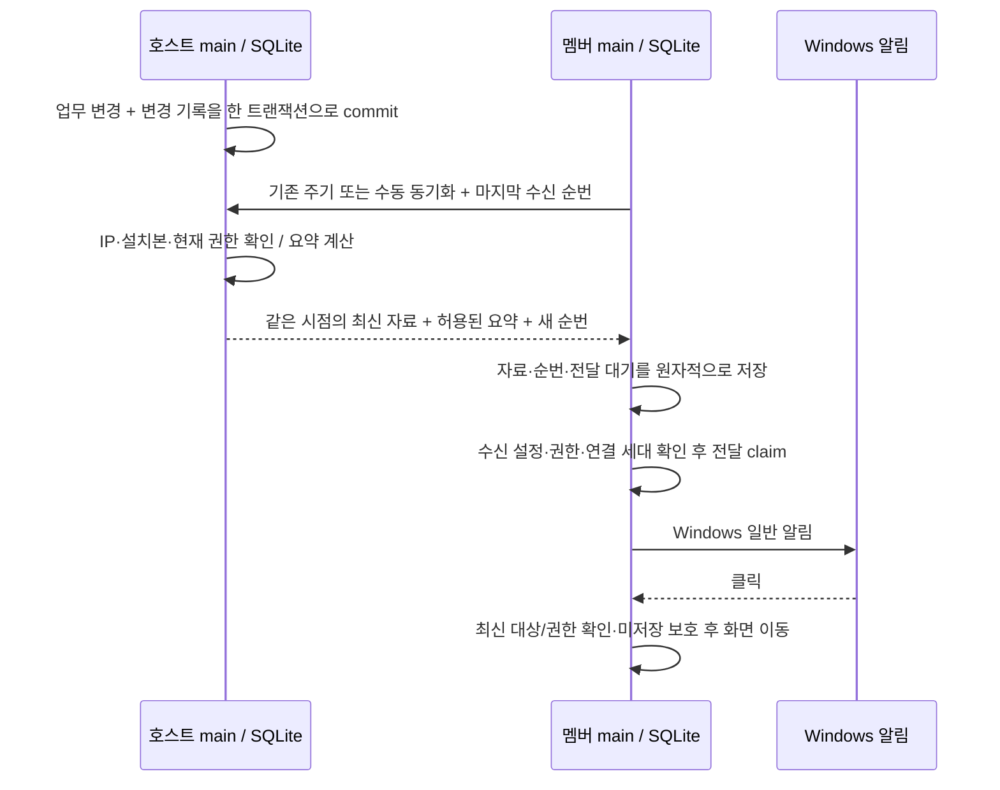

# 공유 변경 Windows 알림 설계

상태: **승인된 설계 — Q1~Q12 및 Q13 문서 전체 확정**. 2026-11-11. 이후 사용자가 구현을 요청했으며 현재 [구현·검증 기록](../implementation/2026-11-11-shared-change-notifications.md)에 진행 상태와 검증 범위를 기록한다.

앞선 제품 변경인 [참여자 한 줄 배치](../implementation/2026-11-11-participant-row.md)와 별개다. [LAN 공유](lan-project-sharing.md)의 권한·TLS·2초 동기화와 [일정 알림](reminders-and-hierarchy.md)의 Windows 전달·미저장 보호를 유지한다. 아래 ‘기술 제안’은 작성자가 제안하고 Q13 문서 전체 확정으로 승인받은 내용이다. Q1~Q12의 개별 답변과 제안의 출처를 구분한다.

## 목적과 범위

호스트가 공유 자료를 바꾸면 해당 자료를 공유받는 멤버가 Windows 일반 알림으로 변경 사실을 알아차릴 수 있게 한다. 개인 자료, 권한 없는 프로젝트, 호스트 자신의 변경은 알리지 않는다. 별도 서버·외부 서비스·Windows 서비스·완전히 종료된 앱 깨우기·변경 이력 조회 화면은 추가하지 않는다. 기존 날짜 기반 시작/종료 알림과 별도 기능이다.

앱 실행 또는 트레이 상태에서 동작한다. Windows 알림 허용·방해 금지·배너 제한의 영향을 받으며 표시·소리·읽음·정확히 한 번 수신을 보장하지 않는다. 앱 종료 중 변경은 다음 정상 동기화에서 재접속 요약 규칙을 적용한다.

## 확정된 사용자 결정

| 질문 | 결정 |
| --- | --- |
| Q1 | 호스트 저장 성공 후 자동 알림. 드래그는 최종 저장 결과 한 번만 대상 |
| Q2 | 새 프로젝트 공유, 공유 프로젝트 이름 변경, 일정 추가·이름/날짜 변경·삭제만 대상. 색상·참여자 표시 이름·자기 알림 설정 변경 제외 |
| Q3 | 멤버 PC별 수신 설정, 기본 켜짐. 날짜 기반 알림과 독립 |
| Q4 | 첫 연결은 ‘프로젝트 N개가 공유되었습니다’ 요약 한 건. 이후 새로 공유받는 프로젝트는 프로젝트별 공유 알림 |
| Q5 | 재접속은 현재 권한이 있는 프로젝트별 요약. 꺼 둔 동안 변경은 다시 켰을 때 소급 알리지 않음 |
| Q6 | 프로젝트 삭제·공유 대상 제외·승인 취소 확인 시 이름/내용 없는 공유 종료 공통 안내 한 건 |
| Q7 | 정상 연결 중에도 한 번의 동기화에서 같은 프로젝트의 수신 변경은 한 건으로 묶음. 단일 변경은 상세, 복수는 요약. 신규 공유는 기존 일정 수와 무관하게 한 건 |
| Q8 | 호스트 기록 최근30일 보관. 기록 부족 시 건수를 추측하지 않고 ‘공유 자료가 최신 상태로 갱신되었습니다’ 안내 한 건 |
| Q9 | 일정 알림→해당 일정 상세, 프로젝트 공유/요약→해당 프로젝트가 보이는 일정 화면, 삭제/공유 종료→현재 프로젝트 목록. 미저장 입력 보호 |
| Q10 | 멤버 공유 설정에 ‘공유 변경 알림’ 스위치. PC에 저장·재실행 후 유지. 끄더라도 동기화·날짜 알림 유지 |
| Q11 | 호스트의 데이터 저장과 변경 기록을 함께 처리. 기존2초 동기화로 최신 자료와 기록을 받아 정상 반영 후 알림 |
| Q12 | 건수는 일정별 최종 결과. 같은 일정 반복 수정=변경1건, 추가 후 수정=추가1건, 추가 후 삭제=생략 |

## 설계 당시 구현과 접근 방식

현재 [host](../../src/main/sharing/host.ts)는 승인 설치본·IP를 검사한 뒤 허용 프로젝트의 전체 snapshot과 ETag를 제공한다. [sync](../../src/main/sharing/sync.ts)는 요청 직렬화·실패 재시도·연결 세대 검사를 수행한다. [cache](../../src/main/db/sharing/cache.ts)는 받은 자료를 원자적으로 반영한다. ETag는 최신 내용 해시이며, renderer의 snapshotRevision은 영속 이벤트 순번이 아니다.

현재 [repository](../../src/main/db/repository.ts)는 알림 설정만 바꿔도 schedule.updated_at을 바꾼다. 따라서 updated_at 차이를 업무 변경으로 취급하면 잘못된 변경 알림이 생긴다. 일정의 소속 프로젝트 변경은 현재 수정 API에 없다.

현재 [native sender](../../src/main/reminders/native.ts)의 Notification 생성·클릭·전달 실패 처리를 활용할 수 있다. 기존 날짜 알림 전송 이력은 일정 삭제와 함께 정리되므로 삭제 알림의 중복 방지 저장소로 재사용할 수 없다.

검토한 방식:

1. **선택: 호스트 변경 기록 + 기존 동기화(Q11).** 원자적 저장과 수신 순번이 필요하지만 재접속·삭제·중간 변경을 복구할 수 있다.
2. snapshot 전후 비교만 사용: 단순하지만 중간 생성/삭제·여러 수정과 권한 변경을 복원하지 못해 Q5·Q8에 맞지 않는다.
3. 별도 실시간 연결: 더 빠를 수 있으나 오프라인 복구에는 여전히 기록이 필요하다. 현재 호스트 포함6PC·10프로젝트 이내·60일정 이내에서 기존 주기 유지가 적절하다.

## 기술 제안: 저장부터 알림까지

### 호스트 기록

- 실제 업무 변경과 이벤트 삽입을 같은 SQLite 트랜잭션으로 묶는다. 기록 실패 시 해당 저장도 rollback한다. commit 이후 OS 전달 실패는 이미 성공한 저장을 되돌리지 않는다.
- 프로젝트 공유 전환/신규 공유, 프로젝트 이름 변경, 일정 생성·업무 필드 변경·삭제, 수신 대상 부여/회수 경로를 모두 포함한다. 개인→공유 전환은 기존 일정별 생성 이벤트가 아니라 신규 공유 이벤트다.
- 정규화한 name/startDate/endDate의 실제 전후 차이를 비교한다. 동일 값 저장, 색상, 알림 설정, 참여자 표시 이름만 바꾸면 업무 이벤트가 없다. ACL 추가/삭제는 해당 PC의 공유 시작/종료로 분리한다.
- 이벤트는 hostId/datasetId, 내부 ID·순서·시각, 프로젝트/일정 ID, 종류, 요약 계산에 필요한 최소 전후 값, 당시 수신 대상과 권한 부여 세대를 보관한다. 개인 데이터나 IP·접속 자격을 알림 내용에 넣지 않는다.
- 동일 PC에 재공유해도 과거 권한 세대의 내용을 소급 전송하지 않는다. 새 수신 대상은 프로젝트 공유 한 건부터 시작한다. 원본 데이터 삭제 후에도 이벤트가30일 유지되도록 일정/프로젝트의 cascade 삭제에 종속시키지 않는다.
- 호스트 기준 UTC 경과30일을 보관 기간으로 사용한다. 정리 후 수신자별 연속 기록의 시작점과 마지막 순번은 별도 보존하여 기록 부족을 판별한다. 조회 시에도 만료 경계를 검사한다. 순서는 벽시계가 아닌 영속 순번으로 판정한다.

### 동기화·권한·중복 처리

- 한 응답은 같은 DB 읽기 시점의 snapshot과 이벤트 상한을 사용한다. 그 이후 저장은 다음 응답에 포함한다. 호스트에서 수신자별 최종 결과를 집계해 응답하며, 필요 없는 전체 내부 이벤트를 멤버에게 공개하지 않는다.
- 수신 순번은 설치본·호스트·dataset·권한 세대에 묶는다. 외부에 노출하는 값으로 개인/타인 프로젝트의 변경 횟수나 내용을 추론하지 못하게 한다. 수신자별 순번 또는 불투명 토큰의 정확한 형식은 구현 계획에서 정한다.
- 현재 권한과 사건 당시 수신 자격을 모두 확인한다. 권한 없는 프로젝트의 ID·이름·일정·수정 횟수는 응답하지 않는다. 이름 없는 회수 안내는 해당 설치본의 기존 공유 종료 확인에만 사용한다.
- 네트워크 오류·IP 불일치·인증서 불일치를 공유 종료로 단정하지 않는다. 기존 인증 경로에서 확정된 REVOKED 또는 인증된 최신 ACL 결과로만 캐시를 제거하고 공통 안내를 만든다. 연결 중 새 회수 사실이 여러 개면 공통 안내 한 건이다. 이후 같은 회수 응답 반복으로 다시 알리지 않도록 영속 처리한다.
- 멤버는 snapshot·수신 순번·대기 알림을 하나의 트랜잭션으로 반영한다. 검증/저장 실패 때는 셋 모두 진행하지 않는다. OS 알림은 이 commit 뒤에만 요청한다.
- 기존 응답 크기·시간·요청 횟수 제한을 유지한다. 완전한 snapshot/요약을 반환할 수 없으면 오류로 끝내고 일부 내용만 적용하거나 순번을 전진시키지 않는다.
- ETag가 같아도 아직 처리하지 않은 이벤트/회수가 있으면 변경 응답을 반환해야 한다. 수동 동기화도 같은 순번·중복 방지 경로를 쓰며 별도 알림을 중복 생성하지 않는다.
- 권한 회수·연결 해제·dataset 변경·수신 끄기는 이미 대기 중인 관련 상세 알림을 취소한다. 일시 연결 끊김 동안에는 새 상세 알림을 보내지 않고 재연결 후 최신 권한/내용으로 다시 집계한다. 아직 claim하지 않은 대기 묶음의 시작 기준과 대상 ID를 보존하여, 이미 전진한 수신 순번 때문에 이 구간이 누락되지 않게 한다. OS 제출이 확정된 묶음은 재집계 대상에서 제외한다. 종료 안내만 회수 처리 이후 허용한다.

### 요약 우선순위와 표시

한 멤버의 마지막 확정 수신 상태부터 이번 응답 상한까지를 한 묶음으로 본다. 재시도와 프로세스 재실행으로 묶음이 중복 전달되지 않도록 멤버 DB에 결정된 묶음 ID를 보관한다.

1. 최초 기능 사용/최초 연결: 현재 허용 프로젝트 수로 요약 한 건. 0개이면 빈 공유 알림은 표시하지 않는다. 그 전에 있었던 개별 변경을 소급하지 않는다.
2. 기록 부족: 현재 자료를 정상 반영한 뒤 공통 갱신 안내 한 건. 정확한 건수·과거 이름을 추정하지 않는다. 같은 응답의 확정 공유 종료는 별도 공통 안내가 가능하나 다른 프로젝트별 변경 요약은 생략한다.
3. 새로 부여된 프로젝트: ‘[프로젝트명] 프로젝트가 공유되었습니다’ 한 건. 포함 일정들을 개별 추가로 세지 않는다.
4. 계속 허용된 프로젝트: 마지막 수신 상태와 최종 상태를 비교해 일정별 추가/변경/삭제로 집계한다. 수정 후 원래 업무 값으로 돌아오면 생략한다. 변경 후 삭제=삭제1건, 추가 후 삭제=생략한다. 프로젝트 이름 변경은 ‘프로젝트 이름 변경’ 항목으로 구분하며 일정 변경 건수에 더하지 않는다.
5. 프로젝트 삭제/권한 회수: 상세 변경 알림보다 종료 안내가 우선한다. 삭제된 프로젝트의 하위 일정 삭제를 따로 알리지 않는다.

재접속 시에는변경 수가1건이어도 프로젝트별 요약으로 표시한다(Q5). 정상 연결 중 단일 일정 변경은 프로젝트명·일정명과 ‘일정 추가’, ‘이름 변경’, ‘기간 변경 · YYYY-MM-DD ~ YYYY-MM-DD’, ‘일정 삭제’ 등의 내용을 표시한다. 같은 저장에서 이름/날짜가 함께 바뀌면 한 알림에 함께 표시한다. 삭제된 일정명은 해당 프로젝트 접근 권한이 여전히 있는 경우에만 사용할 수 있다. 프로젝트별 여러 변경은 ‘추가2건 · 변경3건 · 삭제1건’처럼 요약하며 각 숫자는 고유 일정 수다. 여러 프로젝트는 각각 순서대로 요청하지만 Windows의 모든 배너 표시를 보장하지 않는다.

### PC별 수신 설정

멤버 공유 설정의 작은 스위치 ‘공유 변경 알림’과 설명 ‘공유받은 프로젝트와 일정의 변경을 Windows 알림으로 받습니다.’를 추가하는 제안이다. 개인/호스트 역할에서는 표시하지 않는다. 기존 시작/종료 알림 UI와 기능은 유지한다.

- 기본 ON, 로컬 PC 설정으로 재실행 후 유지한다. 호스트가 이 값을 변경할 수 없다. 설정 저장 실패 시 화면 값을 성공으로 확정하지 않는다.
- OFF이면 OS 전달과 대기 알림을 중단하되 동기화·자료·수신 순번은 계속 갱신한다. 종료 안내도 변경 알림 수신 설정을 따른다. 권한 회수 자체의 화면 상태·캐시 정리는 항상 수행한다.
- OFF→ON 시점의 소급 억제를 위해 다음 정상 동기화까지 기준점 재설정 상태를 영속 저장한다. 그 응답까지는 과거 변경을 알리지 않고 최신 순번을 기준으로 삼는다. 연결이 끊겼다면 이후 첫 정상 동기화가 기준점이며 그 뒤 변경부터 알린다. 이 동안 ‘다음 동기화부터 새 변경 알림을 받습니다’로 안내한다.
- 기존 설치본이 처음 이 기능을 지원하는 버전으로 갱신되면 최초 요약 규칙으로 기준점을 만든다. 의도적 멤버 연결 해제 시 호스트별 순번/대기는 지우되 PC 수신 선호는 유지한다. 다시 승인받으면 새 연결로 취급한다.

### Windows 전달·클릭

기존 날짜 알림의 ‘중복 억제 우선’ 계약을 재사용하는 기술 제안이다. 새 전송 이력은 삭제된 일정도 식별할 수 있도록 원본 일정 FK와 독립한다.

- 대기→claim을 DB에 먼저 저장한 뒤 OS에 제출한다. submitted/failed/unknown을 구분하고 재시작 시 남은 claim은 unknown으로 처리한다. DB 기록 실패 시 전달하지 않는다.
- claim 후 비정상 종료하면 알림이 누락될 수 있다. unknown을 자동 재전송하지 않는다. 확실한 실패는 지속 안내와 사용자 재시도 대상으로 두되, 현재 수신 ON·권한·대상·연결이 유효한 항목만 재시도한다. 재시도 전 최신 상태로 문구를 구성하며 삭제/회수로 무효화된 상세 알림을 되살리지 않는다.
- 클릭 payload는 제한된 종류와 내부 ID만 사용한다. 문자열을 URL·명령으로 실행하지 않는다. 프로젝트/일정의 현재 존재·접근 가능 여부를 다시 확인하고 편집 초안 버리기 확인을 유지한다. 삭제/회수되었으면 현재 프로젝트 목록으로 이동하며 과거 내용을 다시 노출하지 않는다.
- 프로젝트 대상은 숨겨진 필터를 필요한 경우 해제하고 기존 간트/달력 모드를 유지하여 그 프로젝트가 보이게 한다. 멤버는 공유 자료를 편집할 수 없고 자기 알림만 바꿀 수 있다는 기존 권한을 유지한다.
- 이미 OS에 제출한 알림의 과거 내용까지 확실히 회수할 수 있다고 약속하지 않는다. 가능한 활성 알림 닫기를 시도해도 Windows 알림 센터의 흔적 삭제를 보장하지 않는다. 잠금 화면에 이름·날짜가 표시될 수 있다.

## 호환성·저장 변경 제안

신규 동기화 응답과 수신 설정은 main에서 관리하고 제한된 preload API로만 노출한다. 현재 v1 snapshot 계약에 필드를 무조건 덧붙이지 않는다. 새 기능용 endpoint/명시적 capability로 지원 여부를 확인하고 기존 엄격한 검증을 유지한다.

구버전 호스트/멤버 조합은 기존 snapshot 공유를 계속하며 ‘변경 알림을 사용하려면 호스트와 멤버를 업데이트하세요’로 기능 미지원 상태를 구분하는 제안이다. 기존 정상 연결을 단순 버전 차이만으로 오류/회수로 만들지 않는다. 새 기능 지원이 확인된 뒤에는 형식/인증 오류를 구버전으로 간주해 조용히 무시하지 않는다. 실제 메시지·API·테이블 이름과 프로토콜 확장은 구현 계획에서 확정한다.

호스트에는 이벤트·수신 대상/권한 세대·정리 경계, 멤버에는 PC 수신 설정·기준점·수신 순번·독립 전달 이력이 필요하다. 기존 schema v4에서 명시적 migration을 거치며 원본 보존·실패 시 편집 차단 규칙을 따른다. 개인 데이터·개별 일정 알림 설정·기존 자격을 새 기본값으로 덮지 않는다. 토큰 평문·전체 프로젝트 snapshot을 진단 로그에 남기지 않는다.

## 검증 기준과 구현 경계

- 저장 성공/rollback, no-op·색상·알림 설정 제외, 공유 전환과 수신자 추가, 업무 데이터와 이벤트의 원자성.
- 동일 일정 반복 변경·원상복귀·추가 후 삭제·수정 후 삭제, 프로젝트 이름 변경, 신규 공유의 중복 일정 알림 억제.
- 최초0개/N개·기존 설치 갱신·재접속·30일 경계/기록 공백·OFF/ON과 오프라인 재활성화·재시작·수동 동기화 중복 방지.
- 개인·타인·새 권한 세대의 과거 자료 누출 방지. 프로젝트 삭제·ACL 제거·PC 승인 취소/삭제, 네트워크 실패와 실제 회수 구분.
- snapshot/이벤트 동일 시점·응답 제한·잘못된 응답/순번·DB 실패·이전 연결의 지연 응답·프로토콜 혼합 버전.
- cache commit/claim/OS 제출 각 경계의 비정상 종료, unknown 무재전송, 명확한 실패의 제한된 재시도, 삭제 후 전달 이력 유지.
- 클릭 대상 제거/필터/미저장 입력/멤버 읽기 전용, 수신 스위치 저장 실패와 키보드 조작.
- 두 격리 Electron 프로필의 실제 TLS 동기화 및 가짜 OS sender로 전달 요청을 검사하고, Windows 알림 배너·센터·클릭·트레이·방해 금지·실제 사내망은 별도 실기 검증한다. Linux mock 통과를 Windows 전달 성공으로 간주하지 않는다.

Q13 당시에는 설계만 확정했다. 후속 구현 요청에 따라 [구현 계획](../superpowers/plans/2026-11-11-shared-change-notifications.md)과 [실행 기록](../implementation/2026-11-11-shared-change-notifications.md)을 추가했으며, 검증 결과와 실기 한계는 실행 기록을 따른다.

## 설계 검토 기록

2026-11-11 fresh-context builder 검토에서 구현 계획을 막는 중요한 미답변 질문은 발견되지 않았다. 테이블/API/토큰 형식과 코드 연결은 구현 계획에 남겼다. 이 검토는 사용자 문서 승인이나 구현 검증을 대신하지 않는다. Q13에서 문서 전체를 승인했다. 최초 버전 갱신 시 요약, OFF→ON 기준점, 구버전 공유 유지, 중복 억제 우선 전달 정책을 포함한다. 이번 요청은 설계 확정까지만이며 구현 승인을 의미하지 않는다.
