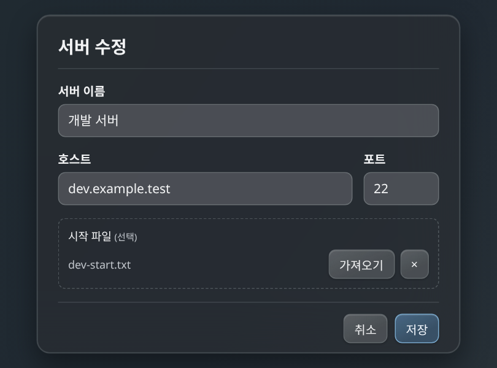

# TermRail 시작 파일 입력과 서버 수정 팝업

2026-11-20 설계 확정. 제품 구현은 후속 작업이다. 기존 [시작 파일 설계](noderail-termrail-installed-feedback.md)와 [서버 편집 설계](workrail-log-home-termrail-help.md)를 기준으로 한다.

## 시작 파일로 서버 열기

사용자가 저장한 서버를 열면 호스트 키를 확인한 후 UTF-8 파일의 첫 두 줄로 SSH 인증을 수행한다. 인증 헤더는 터미널에 입력하거나 화면에 표시하지 않는다. 인증 성공 시 수동 로그인과 동일한 기본 셸을 연다. 두 줄만 있는 파일은 여기에서 바로 수동 입력으로 넘어간다.

셋째 줄이 `ls`인 경우 기본 셸의 첫 명령 프롬프트가 확인되면 해당 줄을 입력하고 Enter를 보낸다. 사용자는 명령 출력과 다음 프롬프트를 같은 터미널에서 보고 이어서 입력한다. 파일 본문을 시작하기 위해 원격 Bash를 별도로 실행할 필요가 없다. 인증 거부 시 명령을 보내지 않는다. 다른 메뉴에서 돌아오거나 별도 창을 메인 창에 붙일 때 이미 보낸 줄을 다시 보내지 않는다. 저장 레이아웃에서 복원된 칸은 기존 ‘시작 파일로 로그인’ 동작을 유지한다.

**상태 표시.** 비밀번호 응답 대기는 ‘인증 중…’, 인증 성공 후 기본 셸 열기는 ‘터미널 여는 중…’으로 표시한다. 셸이 열리면 터미널 출력을 바로 보여 준다. 첫 명령이 대기 중이면 ‘시작 명령 대기 중’으로 표시한다. 앱은 입력 전송과 원격 명령 성공을 구분한다. 자동 입력을 중지해도 정상적으로 열린 셸은 계속 사용할 수 있어야 한다.

### 다음 줄과 수동 입력

한 줄을 보낸 뒤에는 같은 터미널에서 다음 명령을 받을 프롬프트가 돌아온 것을 확인해야 다음 줄을 보낸다. SSH 채널이 열렸다는 응답, 출력이 잠시 멈추는 현상, 출력에 포함된 프롬프트 모양의 문자 하나만으로는 입력 준비를 판정할 수 없다. 인증이 끝난 뒤에도 질문·추가 입력·여러 줄 구문의 계속 입력 프롬프트가 나타나거나 복귀 여부가 불분명하면 남은 줄의 자동 입력을 중단한다. 터미널 출력과 키보드 입력은 유지하고 사용자가 같은 세션에서 직접 이어간다. 중단 후 프롬프트가 다시 나타나더라도 대기 중이던 줄을 뒤늦게 보내지 않는다.

### 기존 시작 파일

변경 버전부터 기존 등록 파일과 새 파일에 동일한 줄 단위 입력을 적용한다. 사용자는 기존 파일을 다시 가져올 필요가 없다. 등록 파일의 암호화 사본과 호스트·포트 연결을 유지한다. 기존 파일의 동작 차이는 업데이트 안내와 TermRail 도움말에 다음과 같이 설명한다.

> 시작 파일은 로그인 후 기본 터미널에 한 줄씩 입력됩니다. 한 줄에 한 명령을 적어 주세요. 여러 줄에 걸친 Bash 구문은 이어지는 입력을 기다릴 수 있습니다. 이때는 터미널에서 직접 이어서 입력하세요.

## 서버 수정 팝업

서버 추가와 수정이 같은 표준 팝업을 사용한다. 최대 너비 460px, 입력 높이 36px, 같은 제목·행 간격과 글래스 배경, 아래 우측 ‘취소’·‘저장’을 적용한다. 수정에서는 서버 이름·호스트·포트와 등록 파일명을 미리 표시한다. 로그인 정보와 파일 본문은 표시하지 않는다. 주소나 포트를 바꾼 경우 파일을 다시 선택하는 기존 절차와 저장·취소의 의미를 유지한다.

## 인수 예시

- 두 줄 파일로 접속하면 기본 셸의 입력이 가능해진다. 셋째 줄을 추가한 파일은 일회성 서버의 비어 있지 않은 작업 디렉터리에서 `ls`가 한 번 실행되고 미리 준비한 파일명이 출력되어야 한다. 이어서 직접 입력한 명령에도 응답해야 한다.
- 기존에 등록한 파일에 `pwd`와 `ls`가 한 줄씩 있으면 재등록 없이 차례로 전송된다. 첫 명령의 일반 출력 중에는 두 번째 줄을 보내지 않는다. 추가 질문이나 계속 입력 프롬프트에서 자동 입력이 중단되고, 사용자가 직접 입력한 뒤에도 남은 줄이 자동 전송되지 않는지 확인한다.
- 인증 거부, 셸 열기 실패, 시작 입력 대기를 화면에서 구분한다. 로그나 진단 복사에는 파일의 로그인 정보나 본문을 포함하지 않는다.
- 표준·좁은 창, 밝은·어두운 테마에서 서버 추가와 수정 창의 필드 배치와 버튼 높이를 비교한다. 수정 후 취소했을 때 원래 값 및 파일 연결을 보존한다.
